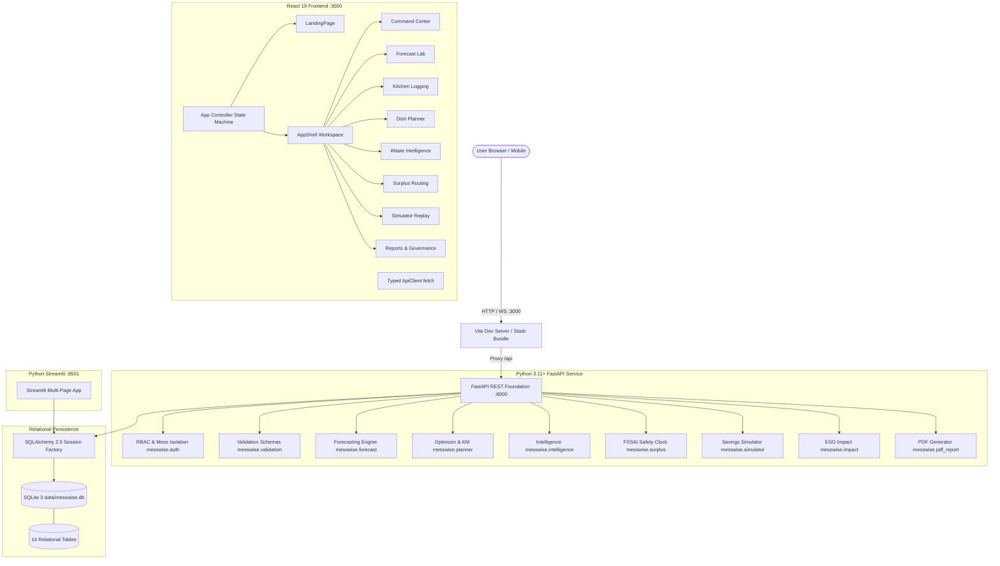
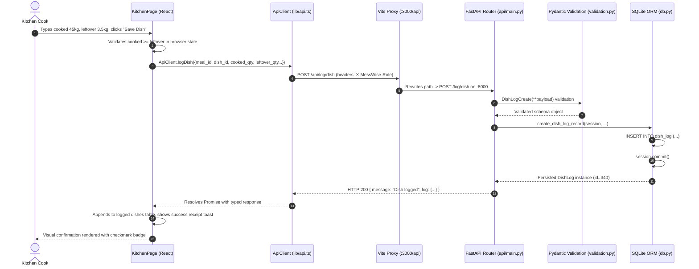
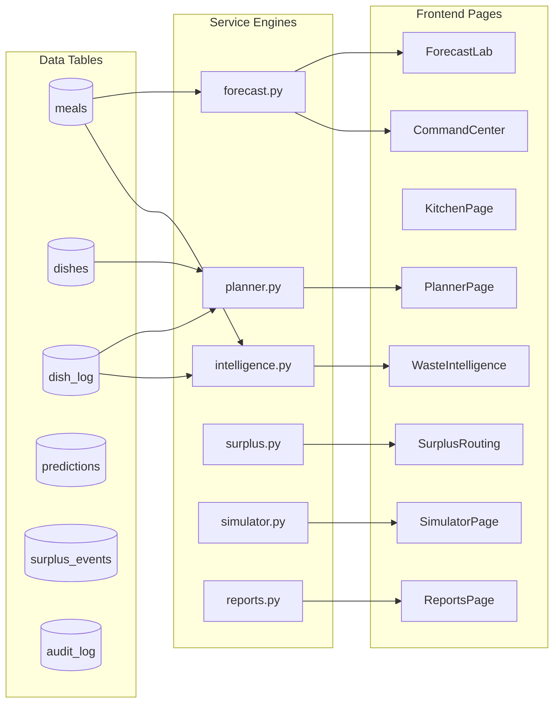
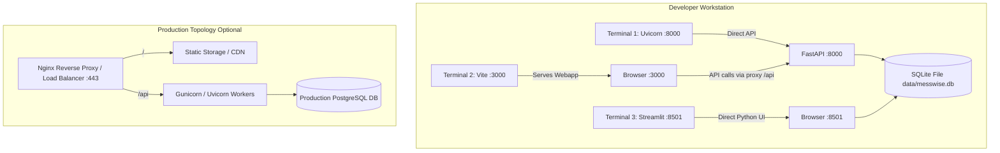

# MESSWISE — COMPLETE SYSTEM KNOWLEDGE DOCUMENTATION
## Exhaustive Product, Frontend, Backend, Database, API, UI/UX, Business Logic, Data Flow, Technology Stack, File-by-File and Component-by-Component Documentation

> **Project Name:** MessWise  
> **Master Edition:** Version 2.0.0 (October 2026)  
> **Institution:** Vasavi College of Engineering (Autonomous), Hyderabad  
> **Theme:** Smart & Sustainable Future — Food-Waste Prevention, Resource Efficiency, Climate Impact  
> **Core Loop:** Predict $\rightarrow$ Plan $\rightarrow$ Cook $\rightarrow$ Measure $\rightarrow$ Learn  
> **Primary Interfaces:**  
> - Modern React 19 Frontend: `http://localhost:3000` (Dev Server)  
> - FastAPI REST Backend: `http://127.0.0.1:8000` (`/docs`, `/redoc`)  
> - Streamlit Fallback Companion: `http://localhost:8501`  
> **Storage:** SQLite 3 (`data/messwise.db`) via SQLAlchemy 2.0+ ORM  

---

## Table of Contents
1. [Executive Summary & Project Overview](#1-executive-summary--project-overview)
   - 1.1 Non-Technical Overview
   - 1.2 Technical Architecture Overview
   - 1.3 The 5-Stage Closed Loop
   - 1.4 Demonstrable Capabilities vs. Planned Roadmap
   - 1.5 Principal Limitations & Candor Disclosures
2. [Problem-to-Solution Mapping Table](#2-problem-to-solution-mapping-table)
3. [Full User Journeys by Persona](#3-full-user-journeys-by-persona)
   - 3.1 Kitchen Manager Journey
   - 3.2 Kitchen Cook / Operator Journey
   - 3.3 Institutional Warden & Auditor Journey
   - 3.4 Student / Diner Journey
   - 3.5 NGO / Food Rescue Partner Journey
4. [Technology Stack & Dependency Inventory](#4-technology-stack--dependency-inventory)
5. [End-to-End System Architecture (5 Mermaid Diagrams)](#5-end-to-end-system-architecture)
   - Diagram A: High-Level System Architecture
   - Diagram B: Frontend-to-Backend Request Lifecycle
   - Diagram C: Operational Data Lifecycle
   - Diagram D: Feature & Service Dependency Graph
   - Diagram E: Deployment & Development Topology
6. [Operational Data Flows (Step-by-Step Traces)](#6-operational-data-flows)
   - Trace 1: Demand Forecast Generation & Conformal Freezing
   - Trace 2: Cooking Quantity Optimization & Batch Rounding
   - Trace 3: Touch & Multilingual Voice Kitchen Measurement Logging
   - Trace 4: Surplus Alert Evaluation & FSSAI 2019 Safety Clock
   - Trace 5: Retrospective Counterfactual Replay & Blind Reveal
   - Trace 6: Matched-Pair Pilot Evidence & ESG PDF Reporting
7. [Database Architecture & Provenance Separation](#7-database-architecture--provenance-separation)
8. [Backend API Architecture & REST Contracts](#8-backend-api-architecture--rest-contracts)
9. [Frontend Architecture & Operational Views](#9-frontend-architecture--operational-views)
10. [Business Logic, Forecasting & Mathematical Models](#10-business-logic-forecasting--mathematical-models)
    - 10.1 Ridge Regression Closed-Form Implementation
    - 10.2 Conformal Prediction Intervals (80% Coverage)
    - 10.3 Shortage-Aware Kaplan-Meier Consumption Learning
    - 10.4 Newsvendor Cost-Aware Criticality Optimization
    - 10.5 Z-Score Anomaly Detection & Statistical Hypotheses
    - 10.6 FSSAI 2019 Time-Temperature Safety Clock Engine
    - 10.7 Peer-Reviewed GHG LCA Carbon & Water Impact Models
11. [Data Validation, Security, Auditing & Food Safety](#11-data-validation-security-auditing--food-safety)
12. [Repository Layout & Source Code Map](#12-repository-layout--source-code-map)
13. [Local Setup, Startup & Verification Guide](#13-local-setup-startup--verification-guide)
14. [Exhaustive Feature Traceability Matrix](#14-exhaustive-feature-traceability-matrix)
15. [Documentation Coverage Audit & Quality Verification](#15-documentation-coverage-audit--quality-verification)

---

## 1. Executive Summary & Project Overview

### 1.1 Non-Technical Overview (For Ordinary Diners, Judges & Evaluators)
Every day, hostel messes, university canteens, corporate cafeterias, and hospital kitchens cook meals for hundreds or thousands of people three to four times a day. These kitchens face an asymmetric operational dilemma:
- **Running short of food** causes immediate, loud student complaints, disruption, and reputational backlash.
- **Over-cooking and throwing away food** happens quietly behind the kitchen door into waste bins.

Because running short is punished immediately while wasting food is invisible, institutional kitchens habitually over-cook by 15% to 30% every single day. The consequences are immense: edible food, cooking gas, electricity, raw ingredients, and public funds are binned, and massive greenhouse gas emissions embedded in that food are released into landfills.

**MessWise turns this guessing game into a closed, learning decision loop.**
Instead of reacting after food is cooked, MessWise acts **before food enters the cooking pot**:
1. It **predicts** how many students will actually attend tomorrow's meal based on historical patterns, calendar schedules (exams, fests, holidays), and weather.
2. It **plans** the exact quantity of rice, dal, curry, and bread to prepare, letting the mess manager choose their desired reliability level (e.g., 95% protection against shortages).
3. It makes **measuring leftovers effortless** for busy kitchen staff via touch screens, voice commands in regional languages (English, Hindi, Telugu), container camera scans, or digital scales.
4. It **learns** from every single meal: if a dish ran out, it recognizes that students wanted more than was served, ensuring the system never under-cooks by mistake.
5. If safe surplus food remains, it tracks a strict **food-safety countdown clock** under national food-safety rules (FSSAI 2019) to alert verified food-rescue charities before the food spoils.

---

### 1.2 Technical Architecture Overview (For Computer Science Students & Engineers)
MessWise is an institutional AI food-operations platform built on a modern decoupled architecture:
- **Frontend Layer:** Built with React 19, TypeScript, Vite 8, Tailwind CSS v4, and Framer Motion. It delivers a 60fps responsive workspace across desktop, tablet, and mobile, featuring 10 operational views, interactive Newsvendor simulations, live FSSAI safety countdown timers, and accessible data visualizations.
- **Backend Service Layer:** Built with FastAPI (Python 3.11+) and Uvicorn, exposing 51 RESTful endpoints adhering to strict OpenAPI schemas with Pydantic validation.
- **Algorithmic Engines:**
  - *Demand Forecasting:* Regularized $L_2$ Ridge regression with pure NumPy closed-form solving and 80% conformal prediction intervals derived from rolling empirical residuals.
  - *Shortage-Aware Consumption Learning:* Non-parametric Kaplan-Meier product-limit survival analysis treating run-out dishes as right-censored observations ($r \ge r_{\text{obs}}$).
  - *Inventory Optimization:* Single-period Newsvendor model calculating economic critical fractiles ($q^* = C_u / (C_u + C_o)$) across dish criticality tiers (staples, mains, sides) with batch rounding.
  - *Safety Clock:* Deterministic state machine enforcing the Food Safety and Standards (Recovery and Distribution of Surplus Food) Regulations, 2019 (FSSAI).
  - *Environmental Accounting:* Multi-factor LCA uncertainty bands ($2.2 / 2.5 / 3.4\text{ kg CO}_2\text{e} / \text{kg food}$) drawn from peer-reviewed institutional food service studies.
- **Storage Layer:** Relational persistence via SQLite 3 (`data/messwise.db`) and SQLAlchemy 2.0+ ORM with non-destructive migrations and strict separation of synthetic benchmark records (`is_synthetic=1`) from real pilot measurements (`is_synthetic=0`).

---

### 1.3 The 5-Stage Closed Loop

```
 ┌────────────────────────────────────────────────────────┐
 │ 1. PREDICT: Headcount & Turnout Range                  │
 │    • Participation rate: H_hat = S * p_hat             │
 │    • 80% Conformal Prediction Band: [H_lo, H_hi]       │
 │    • Honest baselines: Lag-7 and Trailing 4-Meal Avg   │
 └───────────────────────────┬────────────────────────────┘
                             │
                             ▼
 ┌────────────────────────────────────────────────────────┐
 │ 2. PLAN: Cost-Aware Dish Quantities                    │
 │    • Newsvendor fractile: q* = Cu / (Cu + Co)          │
 │    • Dish tiers: Staples 99%, Mains 95%, Sides 90%     │
 │    • Batch rounding: practical cooking pot increments  │
 └───────────────────────────┬────────────────────────────┘
                             │
                             ▼
 ┌────────────────────────────────────────────────────────┐
 │ 3. COOK: Execution & Recipe Scaling                    │
 │    • Recipe ingredient yield scaling                   │
 │    • Prep loss buffer (prep_loss_pct)                  │
 │    • Human-in-the-loop override with recorded reason   │
 └───────────────────────────┬────────────────────────────┘
                             │
                             ▼
 ┌────────────────────────────────────────────────────────┐
 │ 4. MEASURE: Fast Multimodal Kitchen Capture            │
 │    • Rapid touch logging in seconds                    │
 │    • Multilingual voice NLP (English, Hindi, Telugu)   │
 │    • Container photo volume-to-mass proxy              │
 │    • ESP32 smart scale digital tare reading            │
 └───────────────────────────┬────────────────────────────┘
                             │
                             ▼
 ┌────────────────────────────────────────────────────────┐
 │ 5. LEARN: Feedback & Continuous Updating               │
 │    • Kaplan-Meier right-censored appetite learning     │
 │    • Z-score anomaly detection & root causes           │
 │    • Champion-challenger model retraining & drift      │
 └───────────────────────────┬────────────────────────────┘
                             │
                             └────────── Loops back to PREDICT
```

---

### 1.4 Demonstrable Capabilities vs. Planned Roadmap

| Capability / Module | Current Implementation Status | How It Is Implemented Today | Roadmap / Next Steps |
| :--- | :--- | :--- | :--- |
| **Headcount Forecasting** | Implemented & Verified | Ridge regression ($L_2$) + 80% conformal rolling residual band | Multi-hostel cross-learning, deep neural net integration |
| **Newsvendor Optimizer** | Implemented & Verified | Closed-form $q^* = k / (k + 1)$ with batch rounding & safety floors | Real-time dynamic vegetable wholesale price sync |
| **Kaplan-Meier Learning** | Implemented & Verified | Product-limit survival estimator on historical dish logs | Bayesian hierarchical appetite distributions |
| **Kitchen Touch Logging** | Implemented & Verified | Fast touch screen form with meal/dish validation | Direct kitchen hardware kiosk casing |
| **Voice Logging NLP** | Implemented & Verified | In-memory multilingual parser for EN, HI, TE synonyms & numbers | Fine-tuned acoustic Whisper model for loud kitchens |
| **Photo Waste Estimator** | Implemented & Verified | Calibrated container geometry (20L, 50L, 8L) + bulk density factors | Edge computer vision segmented depth map estimation |
| **FSSAI Surplus Clock** | Implemented & Verified | Deterministic 4h hot / 2h ambient clock with temperature validation | IoT BLE probe continuous thermal telemetry |
| **NGO WhatsApp Draft** | Implemented & Verified | Pre-filled `https://wa.me/` draft generated on manager sign-off | Direct NGO webhook API routing |
| **Carbon LCA Accounting**| Implemented & Verified | Peer-reviewed uncertainty band ($2.2 - 3.4\text{ kg CO}_2\text{e}/\text{kg}$) | Dish-specific ingredient lifecycle carbon database |
| **Matched-Pair Pilot E2**| Implemented & Verified | Matched weekday $\times$ meal with bootstrap 95% confidence intervals | Multi-semester longitudinal randomized trial |
| **Multi-Mess RBAC** | Implemented & Verified | Action-level permission matrix with site isolation | OpenID Connect / SAML enterprise SSO |

---

### 1.5 Principal Limitations & Candor Disclosures
MessWise enforces strict scientific and operational honesty:
1. **Synthetic vs. Real Separation:** When zero verified pilot meals are recorded in the database, the system outputs:
   `"Insufficient real pilot data: 0 verified meals recorded"`. It **never** fabricates real-world savings or environmental impact from artificial benchmark records.
2. **Ingredient Purchase Costs:** Unless the mess manager explicitly configures ingredient costs in the recipe catalog, cost savings in Rupees are reported as **Unavailable** rather than fabricated from national averages.
3. **Food Safety Authority:** MessWise does not physically verify food edibility. The safety clock is an **advisory compliance tool** enforcing FSSAI 2019 parameters. A human supervisor must confirm that food shows no signs of spoilage or contamination.
4. **Hardware Integration:** The voice, photo, scale, and temperature features are verified software adapters with manual verification fallbacks; they do not depend on proprietary closed-source hardware.

---

## 2. Problem-to-Solution Mapping Table

| Documented Requirement (PLAN.md) | Operational Impact | MessWise Technical Solution | Primary UI Page | Backend Service & Route | Database Tables | Implementation Status |
| :--- | :--- | :--- | :--- | :--- | :--- | :--- |
| **A1: Headcount Forecast** | Kitchens cook for arbitrary headcount guesses | Ridge regression with 80% conformal uncertainty intervals | `ForecastLab.tsx` | `messwise/forecast.py`<br>`GET /forecast` | `meals`, `predictions` | Implemented & Verified |
| **A2: Honest Baselines** | AI claims superiority without comparative proof | Side-by-side comparison with Lag-7 and Trailing 4-Meal Average | `ForecastLab.tsx`, `CommandCenter.tsx` | `messwise/forecast.py`<br>`GET /forecast` | `meals`, `predictions` | Implemented & Verified |
| **A6: 80% Prediction Band** | Point forecasts give false impression of exactness | Conformal empirical residuals deriving $[H_{\text{lo}}, H_{\text{hi}}]$ | `ForecastLab.tsx` | `messwise/forecast.py` | `predictions` | Implemented & Verified |
| **B1/B3: Dish Quantity Plan**| Over-cooking caused by habit | Recommended batch $Q_d = \lceil (H_q \cdot r_d \cdot (1 + \text{loss})) / B \rceil B$ | `PlannerPage.tsx` | `messwise/planner.py`<br>`POST /plan` | `dishes`, `dish_log` | Implemented & Verified |
| **B4: Cost-Aware Optimizer** | Staples and sides treated with identical risk | Newsvendor $q^* = k / (k + 1)$ with tier defaults (99%, 95%, 90%) | `PlannerPage.tsx` | `messwise/planner.py`<br>`POST /plan/costing` | `dishes`, `overrides` | Implemented & Verified |
| **B5: Shortage-Aware KM** | Run-out dishes cause models to under-cook future meals | Kaplan-Meier product-limit curves on right-censored data | `PlannerPage.tsx` | `messwise/planner.py` | `dish_log` | Implemented & Verified |
| **C1–C4: Touch Logging** | Manual paper registers are lost or skipped | 30-second mobile/tablet touch logging for meals and dishes | `KitchenPage.tsx` | `messwise/validation.py`<br>`POST /log/meal`, `/log/dish`| `meals`, `dish_log` | Implemented & Verified |
| **C5: Multilingual Voice** | Cooks cannot type on smartphones with wet hands | Speech parser for English, Hindi, Telugu with dish synonyms | `KitchenPage.tsx` | `messwise/voice.py`<br>`POST /kitchen/voice-parse` | In-memory NLP | Implemented & Verified |
| **C6: Photo Waste Proxy** | Scales are not always available next to waste bins | Calibrated container fill proxy with dish bulk densities | `KitchenPage.tsx` | `messwise/photo_waste.py`<br>`POST /kitchen/photo-estimate`| In-memory image | Implemented & Verified |
| **C7: Entrance Tallies** | Turnout swings during service cannot be managed | 15-minute entrance tallies + empirical nowcasting $n / a(\tau)$ | `KitchenPage.tsx` | `messwise/tally.py`<br>`POST /kitchen/tally` | `entrance_tallies` | Implemented & Verified |
| **D1–D3: Waste Intelligence** | Managers cannot see which dishes cause waste | Grouped weekday charts, dish rankings, Z-score anomalies | `WasteIntelligencePage.tsx` | `messwise/intelligence.py`<br>`GET /intelligence/summary`| `dish_log`, `meals` | Implemented & Verified |
| **E1: Frozen Prediction Log**| Teams alter predictions after observing outcomes | Immutable pre-meal forecast log frozen before service | `ForecastLab.tsx` | `messwise/forecast.py`<br>`GET /prediction-log` | `predictions` | Implemented & Verified |
| **E2: Matched-Pair Pilot** | Pilot claims confounded by holidays or fests | Matched weekday $\times$ meal with bootstrap 95% CIs | `ReportsPage.tsx` | `messwise/reports.py`<br>`GET /reports/evidence` | `meals`, `dish_log` | Implemented & Verified |
| **E3/E4: Simulator Replay** | Cannot evaluate policy changes safely | Pre-cutoff replay without leakage & 2-stage blind reveal | `SimulatorPage.tsx` | `messwise/simulator.py`<br>`POST /simulate` | `meals`, `predictions`| Implemented & Verified |
| **G1/G2: FSSAI Surplus Clock**| Surplus spoiled before rescue; risk of food poisoning | 4h hot / 2h ambient countdown timer & temperature gates | `SurplusRoutingPage.tsx` | `messwise/surplus.py`<br>`GET /surplus/alerts` | `surplus_events` | Implemented & Verified |
| **H1/H2: ESG Impact Engine** | Greenwashing claims without peer-reviewed proof | Farm-to-plate LCA uncertainty bands ($2.2 - 3.4\text{ kg CO}_2\text{e}$) | `ImpactPage.tsx` | `messwise/impact.py`<br>`GET /impact/summary` | `dish_log`, `meals` | Implemented & Verified |

---

## 3. Full User Journeys by Persona

### 3.1 Kitchen Manager Journey
1. **Morning Briefing:** Opens the `CommandCenter.tsx`. Inspects today's turnout forecast $\hat{H}$ (e.g. 450 diners, 80% interval: 425–475) and checks the Service Level Reliability metric.
2. **Menu Planning:** Navigates to `PlannerPage.tsx`. Selects lunch dishes (`Rice`, `Dal Tadka`, `Aloo Sabzi`, `Curd`). Adjusts service-level slider to 95%. Reviews Newsvendor batch suggestions.
3. **Managing Overrides:** If the manager knows 30 students are leaving early for a sports match, they click **"Override Quantity"**, enter 40 kg (down from 45 kg), and type the mandatory justification *"Inter-college cricket team away match"*. The adjustment is saved to `overrides` and logged in `audit_log`.
4. **Mid-Service Monitoring:** Checks the `SurplusRoutingPage.tsx` to see if early predicted surplus alerts require partner coordination.
5. **Evening Reporting:** Reviews `WasteIntelligencePage.tsx` to check today's leftover percentages and inspect any Z-score anomalies.

### 3.2 Kitchen Cook / Operator Journey
1. **Prep & Cooking:** Mounts a tablet in the kitchen showing `KitchenPage.tsx`. Views the target cooked quantities for each dish in standard pot increments.
2. **Post-Service Logging:**
   - *Via Touch:* Selects `Rice`, inputs 45 kg cooked, 3.5 kg leftover, clicks save.
   - *Via Voice:* Presses the microphone button and speaks: *"Chawal cooked 45 kilo, leftover 3.5 kilo"*. The NLP engine parses the quantities, populates the review slots, and the cook clicks confirm.
   - *Via Smart Scale:* Places leftover vessel on load-cell platform. System reads tare weight, verifies stable reading, and fills the leftover field.
3. **Run-Out Event:** If `Dal Tadka` ran out at 1:45 PM before service ended, the cook ticks the **"Ran Out"** checkbox. This marks the record as right-censored so the Kaplan-Meier algorithm learns that student appetite was higher than served.

### 3.3 Institutional Warden & Auditor Journey
1. **Pilot Evaluation:** Opens `ReportsPage.tsx` $\rightarrow$ **Pilot Evidence Tab**.
2. **Inspecting Matched Pairs:** Reviews baseline vs. pilot leftover comparisons across identical weekdays and meal types. Verifies that fests and exam periods were excluded.
3. **Statistical Scrutiny:** Checks the 95% bootstrap confidence interval on food-waste reduction.
4. **Governance Review:** Switches to the **Audit Governance Tab** to inspect all administrative actions, model retraining events, and cook overrides.
5. **ESG Certification:** Opens `ImpactPage.tsx` and clicks **"Download Official Green Campus PDF Report"** for institutional sustainability compliance.

### 3.4 Student / Diner Journey
1. **Pre-Meal Intent:** Scans QR code outside mess hall. Opens anonymous check-in screen (`POST /student/check-in`). Taps **"Yes"** for lunch. Device hash is one-way SHA-256 salted; zero personal roll numbers or names are collected.
2. **Post-Meal Feedback:** Rates the meal 4 stars and rates `Paneer Butter Masala` 5 stars (`POST /student/rate`).
3. **Impact Awareness:** Views the public **Student Impact Wall** mounted on dining hall displays, showing live campus food waste saved, carbon avoided, and equivalent meals rescued.

### 3.5 NGO / Food Rescue Partner Journey
1. **Surplus Notification:** Receives alert that 14 kg of hot-held `Dal Tadka` is available.
2. **Safety Verification:** Inspects the FSSAI Food-Safety Clock. Verifies that cooking completed at 1:30 PM, the core temperature was measured at $68.5^\circ\text{C}$ ($\ge 65^\circ\text{C}$), and the food is safe until 5:30 PM (4-hour hot window).
3. **Dispatch Coordination:** Manager approves donation. Pre-filled WhatsApp dispatch message is transmitted with dish name, volume, temperature, and collection location.

---

## 4. Technology Stack & Dependency Inventory

The following table documents every technology present in the codebase, its exact version, and its verified architectural responsibility.

| Technology | Actual Version | Responsibility in MessWise | Where Used | Key Dependencies | Evidence File |
| :--- | :--- | :--- | :--- | :--- | :--- |
| **React** | `19.2.8` | Component rendering & reactive UI state | `frontend/src/` | `react-dom` | `frontend/package.json` |
| **TypeScript** | `6.0.2` | Static typing, interface definitions & contracts | Entire frontend | Node.js | `frontend/package.json` |
| **Vite** | `8.3.0` | Local dev server, HMR, bundling & API proxy | `frontend/vite.config.ts` | Rollup, esbuild | `frontend/package.json` |
| **Tailwind CSS** | `4.3.3` | Utility-first styling & dark-mode variant | `frontend/src/index.css` | `@tailwindcss/vite` | `frontend/package.json` |
| **Framer Motion** | `14.1.0` | Micro-animations (stagger, split, spring, tilt) | `components/animations/` | React | `frontend/package.json` |
| **Lucide React** | `1.55.0` | Iconography across navigation, cards & buttons | Entire frontend | React | `frontend/package.json` |
| **Python** | `3.11+` | Backend runtime & scientific computing | Entire backend | None | `requirements.txt` |
| **FastAPI** | `0.100.0+` | RESTful API gateway, route handling & validation| `api/main.py` | Starlette, Pydantic | `requirements.txt` |
| **Uvicorn** | `0.23.0+` | ASGI high-performance HTTP server | API server startup | Python asyncio | `requirements.txt` |
| **SQLAlchemy** | `2.0.0+` | Declarative ORM & SQLite session management | `messwise/db.py` | typing-extensions | `requirements.txt` |
| **SQLite 3** | Embedded | Zero-maintenance ACID relational persistence | `data/messwise.db` | C standard library | SQLite binary |
| **Pydantic** | `2.0.0+` | Request/response data validation & schemas | `messwise/validation.py`| Python core | `requirements.txt` |
| **NumPy** | `1.24.0+` | Closed-form Ridge solver, arrays & quantiles | `forecast.py`, `planner.py`| OpenBLAS | `requirements.txt` |
| **Pandas** | `2.0.0+` | Time-series manipulation, matching & lag features| `reports.py`, `intelligence.py`| NumPy | `requirements.txt` |
| **ReportLab** | `4.0.0+` | Programmatic Green Campus audit PDF generator | `messwise/pdf_report.py`| Pillow | `requirements.txt` |
| **Streamlit** | `1.30.0+` | Interactive companion / legacy fallback UI | `app/Home.py` | Tornado, Altair | `requirements.txt` |
| **Pytest** | `8.0.0+` | Automated test suite execution (248 tests) | `tests/` | pluggy, iniconfig | `requirements.txt` |
| **Puppeteer Core** | `25.13.0` | Automated headless Edge contrast verification | `scripts/audit_visual.cjs`| Chromium/Edge | `frontend/package.json` |

---

## 5. End-to-End System Architecture

### Diagram A: High-Level System Architecture


---

### Diagram B: Frontend-to-Backend Request Lifecycle


---

### Diagram C: Operational Data Lifecycle

```mermaid
stateDiagram-v2
    [*] --> PREDICT : Historical meals & calendar flags
    PREDICT --> PLAN : Frozen forecast H_hat & 80% interval [H_lo, H_hi]
    PLAN --> COOK : Dish batches Q_d with batch rounding & safety floor
    COOK --> MEASURE : Kitchen prepares food; human overrides recorded
    MEASURE --> LEARN : Touch, voice, container photo or scale measurements
    MEASURE --> SURPLUS : Edible leftovers evaluated against FSSAI clock
    SURPLUS --> NGO_DISPATCH : Hot/Cold holding verified & manager approved
    SURPLUS --> DISMISS : Expired or temperature danger zone
    LEARN --> PREDICT : Kaplan-Meier appetite quantile & Z-score anomalies
```


---

### Diagram D: Feature & Service Dependency Graph


---

### Diagram E: Deployment & Development Topology


---

## 6. Operational Data Flows (Step-by-Step Traces)

### Trace 1: Demand Forecast Generation & Conformal Freezing
1. **User Action:** Kitchen manager visits `ForecastLab.tsx`, selects tomorrow's date, chooses `Lunch`, and clicks **"Generate Forecast"**.
2. **React Handler:** `handleGenerateForecast()` in `ForecastLab.tsx` validates date string format (`YYYY-MM-DD`).
3. **API Client:** Calls `apiClient.getForecast({ date, meal_type: 'lunch', hostel_strength: 500, is_synthetic: 1 })`.
4. **HTTP Call:** Issues `GET /api/forecast?date=2026-10-16&meal_type=lunch&hostel_strength=500&is_synthetic=1`.
5. **FastAPI Route:** `api/main.py:get_forecast` intercepts request, injecting `session = get_db_session()`.
6. **Feature Extraction:** `messwise.forecast.extract_features()` queries historical meals strictly prior to target date (`Meal.date < target_date`), constructing day-of-week one-hot encoding, calendar event flags, and 7-day attendance lags.
7. **Ridge Model Prediction:** Pure NumPy `RidgeRegression.predict()` solves for participation rate $\hat{p}$. Headcount point estimate is calculated as $\hat{H} = \text{round}(S \cdot \hat{p})$.
8. **Conformal Interval:** Computes 80th percentile absolute rolling residual $q_{80}$ across historical evaluations. Derives bounds $H_{\text{lo}} = \hat{H} - q_{80}$ and $H_{\text{hi}} = \hat{H} + q_{80}$.
9. **Freezing Snapshot:** Inserts frozen prediction record into `predictions` table with status `'pending'`.
10. **UI Render:** Frontend displays point estimate $\hat{H}$ with uncertainty badge and baseline comparison cards.

---

### Trace 2: Cooking Quantity Optimization & Batch Rounding
1. **User Action:** Cook navigates to `PlannerPage.tsx`, adjusts the service level slider to 95%, and clicks **"Compute Optimized Plan"**.
2. **React Handler:** `handleComputePlan()` packages dish list into JSON payload.
3. **HTTP Call:** `POST /api/plan` sending `{ date, meal_type, target_service_level: 0.95, dishes: ['Rice', 'Dal Tadka'] }`.
4. **FastAPI Route:** `api/main.py:plan_cooking_quantities`.
5. **Service Headcount:** Evaluates empirical forecast residuals to calculate planning turnout $H_q$ corresponding to 95% protection.
6. **Kaplan-Meier Appetite Rate:** For each dish, `messwise.planner.compute_kaplan_meier_consumption_rate()` retrieves historical dish logs. If dish ran out in past meals, it applies product-limit survival estimation to calculate consumption quantile $r_q$.
7. **Newsvendor Criticality:** Determines economic service fractile $q^* = k / (k + 1)$ based on dish tier (Staple 99%, Main 95%, Side 90%).
8. **Exact Batch Formula:** Calculates theoretical mass:
   $$Q_{\text{exact}} = H_q \cdot r_d \cdot (1 + \text{prep\_loss\_pct})$$
9. **Practical Batch Rounding:** Rounds $Q_{\text{exact}}$ upwards to the nearest cooking pot increment (e.g., $42.4\text{ kg} \rightarrow 45.0\text{ kg}$ in 5 kg batches).
10. **UI Render:** Displays recommended batches, buffer quantities, and prep loss margins in interactive cards.

---

### Trace 3: Touch & Multilingual Voice Kitchen Measurement Logging
1. **User Action:** Cook clicks microphone button in `KitchenPage.tsx` and speaks: *"Rice cooked 40 kg, leftover 4 kg"*.
2. **Audio NLP:** `POST /api/kitchen/voice-parse` transmits audio stream. `messwise.voice.parse_kitchen_speech()` normalizes regional synonyms (*annam*, *chawal*, *rice*) and maps semantic cues (*cooked*, *leftover*) to form quantities.
3. **Human Review:** Frontend populates review fields in the dish table. Cook confirms numbers and clicks **"Save All Dish Measurements"**.
4. **HTTP Call:** `POST /api/log/dish` sending `{ meal_id: 102, dish_id: 1, cooked_qty: 40.0, leftover_qty: 4.0, unit: 'kg' }`.
5. **Database Mutation:** Inserts row into `dish_log`. If leftover $> 0$, automatically generates a potential surplus alert in `surplus_events`.

---

### Trace 4: Surplus Alert Evaluation & FSSAI 2019 Safety Clock
1. **Trigger:** Measured leftover of 14 kg `Dal Tadka` logged.
2. **Alert Creation:** `messwise.surplus.create_measured_surplus_alerts()` creates row in `surplus_events` with `eligibility_status = 'pending_inspection'`.
3. **Temperature Measurement:** Supervisor measures core temperature using probe ($68.5^\circ\text{C}$), selects `Hot Held`, and submits inspection modal.
4. **Safety Evaluation:** `messwise.surplus.evaluate_food_safety_clock()` verifies:
   - $T = 68.5^\circ\text{C} \ge 65.0^\circ\text{C}$ (Complies with FSSAI Hot Holding threshold).
   - Elapsed time ($1.5\text{ h}$) is within the 4.0-hour hot-holding safe window.
   - Updates `eligibility_status = 'eligible'`.
5. **Manager Sign-Off:** Manager clicks **"Approve for Rescue"**. Status changes to `'approved'`, and system generates pre-filled WhatsApp click-to-chat URL for verified NGO coordinator.

---

### Trace 5: Retrospective Counterfactual Replay & Blind Reveal
1. **Replay Trigger:** User clicks **"Run Counterfactual Replay"** in `SimulatorPage.tsx`.
2. **Zero-Leakage Enforcement:** `messwise.simulator.run_savings_simulation()` iterates chronologically over historical meals. For each meal $m_t$, models are trained strictly using meals $m_i$ where $i < t$.
3. **Unit-Consistent Comparison:** Groups historical actual cooked quantities vs simulated recommendations strictly by unit (`kg`, `L`, `count`), reporting potential food waste reduction without inferring unobserved appetite on run-out days.
4. **Blind Reveal Stage 1:** Freezes pre-service plan into `predictions` with actual headcount masked.
5. **Blind Reveal Stage 2:** User clicks **"Reveal Measured Outcome"**. Unmasks actual headcount, evaluates frozen plan, and displays error metrics.

---

### Trace 6: Matched-Pair Pilot Evidence & ESG PDF Reporting
1. **Pilot Evaluation:** User visits `ReportsPage.tsx`.
2. **Matched Pairs:** `messwise.reports.compute_pilot_evidence_report()` matches each baseline meal with an identical pilot weekday $\times$ meal type (e.g. Tuesday Lunch to Tuesday Lunch), excluding event and exam days.
3. **Bootstrap CI:** Executes 1,000 nonparametric bootstrap iterations (seed 42) to establish 95% confidence intervals on waste reduction percentage.
4. **PDF Generation:** User clicks **"Download Official PDF Report"**. `messwise.pdf_report.generate_green_campus_pdf()` builds a multi-page PDF with institutional headers, executive summary, tables, and FSSAI/SDG citations using ReportLab.

---

## 7. Database Architecture & Provenance Separation

MessWise uses an embedded **SQLite 3** relational database (`data/messwise.db`) managed via **SQLAlchemy 2.0+ Declarative ORM**.

### 7.1 Relational Schema Summary (14 Tables)
1. **`meals`:** Meal attendance, capacity, calendar flags, and weather context.
2. **`dishes`:** Dish catalog, units, prep loss factors, and economic criticality tiers.
3. **`dish_log`:** Per-meal cooked mass, leftover mass, run-out events, and logging method.
4. **`predictions`:** Frozen pre-service turnout forecasts, 80% intervals, baselines, and errors.
5. **`overrides`:** Human adjustments to algorithm recommendations with mandatory justifications.
6. **`audit_log`:** Immutable audit trail tracking administrative actions and model promotions.
7. **`surplus_events`:** FSSAI 2019 time-temperature holding observations, countdowns, and NGO routing.
8. **`entrance_tallies`:** 15-minute privacy-preserving aggregate diner arrival counts.
9. **`campus_events`:** Academic exam schedules and campus fests.
10. **`meal_checkins`:** Anonymous pre-meal student attendance declarations (Yes/No/Maybe).
11. **`meal_ratings`:** Anonymous 1-to-5 star dish feedback for menu quality.
12. **`model_registry`:** Model versions, hyperparameters, WAPE/MAE metrics, and champion status.
13. **`recipes`:** Standard recipe yield specifications linking dishes to ingredients.
14. **`recipe_ingredients`:** Raw ingredient amounts and configured purchase costs.

*For complete column-by-column schema tables and lifecycle examples, see [`docs/MESSWISE_DATABASE_REFERENCE.md`](file:///c:/Users/kotha/Desktop/Messwise/Messwise/docs/MESSWISE_DATABASE_REFERENCE.md).*

---

## 8. Backend API Architecture & REST Contracts

The FastAPI application (`api/main.py`) exposes **51 custom REST endpoints** supporting full CRUD and analytical operations across the platform.

### Master Route Architecture
- **System & Liveness:** `GET /health`
- **Kitchen Logging:** `POST /log/meal`, `POST /log/dish`, `GET /meals`, `GET /meals/{id}`, `GET /dishes`, `POST /dishes`
- **Demand Forecasting:** `GET /forecast`, `GET /prediction-log`
- **Optimization & Planning:** `POST /plan`, `POST /plan/topup`, `POST /plan/what-if`, `POST /plan/procurement`, `POST /plan/costing`
- **Waste Intelligence:** `GET /intelligence/summary`
- **Surplus & Food Safety:** `GET /surplus/alerts`, `POST /surplus/alerts/predicted`, `POST /surplus/alerts/measured`, `POST /surplus/alerts/{id}/safety`, `POST /surplus/alerts/{id}/decision`
- **Simulation & Replay:** `POST /simulate`, `POST /simulate/blind-forecast`, `POST /simulate/blind-reveal`
- **Impact & Governance:** `GET /impact/summary`, `GET /impact/pdf-report`, `GET /reports/evidence`, `GET /reports/audit-events`
- **Multimodal Adapters:** `POST /kitchen/voice-parse`, `POST /kitchen/photo-estimate`, `POST /kitchen/scale-reading`, `POST /kitchen/tally`

*For complete request/response schemas, error codes, and curl examples for all 51 endpoints, see [`docs/MESSWISE_API_REFERENCE.md`](file:///c:/Users/kotha/Desktop/Messwise/Messwise/docs/MESSWISE_API_REFERENCE.md).*

---

## 9. Frontend Architecture & Operational Views

The frontend is a decoupled React 19 application built with TypeScript and styled using custom CSS design tokens and Tailwind CSS v4.

### 9.1 The Ten Primary Pages
1. **Landing Page (`LandingPage.tsx`):** Public marketing page with hero text animations, closed-loop process cards, and client-side simulation sliders.
2. **Command Center (`CommandCenter.tsx`):** Operational dashboard displaying KPI count-up cards, next-meal forecast, baseline comparison, and recent kitchen logs.
3. **Forecast Lab (`ForecastLab.tsx`):** Predictive laboratory with 80% conformal prediction bands, explainability driver charts, and historical prediction log.
4. **Kitchen Logging (`KitchenPage.tsx`):** Rapid touch logging table, multilingual voice microphone helper, container photo estimator, and smart scale tare parser.
5. **Dish Planner (`PlannerPage.tsx`):** Newsvendor quantity optimizer, service-level sliders, dish criticality tiers, batch rounding, and manager override modal.
6. **Waste Intelligence (`WasteIntelligencePage.tsx`):** Retrospective analytics, weekday and meal-type pattern charts, dish performance rankings, and Z-score anomalies.
7. **Sustainability & Impact (`ImpactPage.tsx`):** Farm-to-plate LCA carbon mitigation bands ($2.2 - 3.4\text{ kg CO}_2\text{e}$), meals-equivalent, and PDF report download.
8. **Surplus Routing (`SurplusRoutingPage.tsx`):** Real-time FSSAI 2019 countdown clock, core temperature inspection modal, manager approval, and WhatsApp dispatch draft.
9. **Counterfactual Simulator (`SimulatorPage.tsx`):** Pre-cutoff historical replay without leakage and two-stage blind forecast reveal.
10. **Reports & Governance (`ReportsPage.tsx`):** Matched-pair before/after pilot comparison with bootstrap 95% CIs and immutable audit trail table.

*For complete button inventories, form input references, and shared component specifications, see [`docs/MESSWISE_FRONTEND_UI_CATALOG.md`](file:///c:/Users/kotha/Desktop/Messwise/Messwise/docs/MESSWISE_FRONTEND_UI_CATALOG.md).*

---

## 10. Business Logic, Forecasting & Mathematical Models

### 10.1 Ridge Regression Closed-Form Implementation
To prevent dependency breakage on fragile C-extensions across different operating systems, MessWise implements a pure NumPy $L_2$-regularized Ridge linear regression (`messwise/forecast.py`):
$$w = (X_c^T X_c + \alpha I)^{-1} X_c^T y_c$$
$$b = \bar{y} - \bar{x} w$$
Where $X_c = X - \bar{x}$ and $y_c = y - \bar{y}$. The model predicts attendance participation rate $p \in [0, 1]$, and scales by hostel strength $S$:
$$\hat{H} = \text{round}(S \cdot \hat{p})$$

### 10.2 Conformal Prediction Intervals (80% Coverage)
Rather than assuming Gaussian error distributions, MessWise applies non-parametric conformal prediction. It computes rolling absolute residuals on historical meals:
$$e_t = |H_t - \hat{H}_t|$$
Taking the 80th empirical percentile $q_{80} = \text{Quantile}(e, 0.80)$, the uncertainty interval is:
$$H_{\text{lo}} = \max(0, \hat{H} - q_{80}), \quad H_{\text{hi}} = \min(S, \hat{H} + q_{80})$$

### 10.3 Shortage-Aware Kaplan-Meier Consumption Learning
When a dish runs out before service ends (`ran_out == 1`), the observed consumption rate $r_{\text{obs}} = \text{served} / H$ represents a **lower bound** on student appetite ($r \ge r_{\text{obs}}$). Naive averages treat this as full demand, systematically under-cooking future meals.
MessWise uses the Kaplan-Meier product-limit estimator (`messwise/planner.py`):
$$S(r) = \prod_{i: r_i \le r} \left(1 - \frac{d_i}{n_i}\right)$$
Where $d_i$ is the number of exact consumption observations at rate $r_i$, and $n_i$ is the number of meals with consumption $\ge r_i$. The learned consumption rate is the quantile $r_q$ where $S(r_q) \le 1 - q$.

### 10.4 Newsvendor Cost-Aware Criticality Optimization
The single-period Newsvendor model balances shortage penalties against waste costs:
- Shortage penalty: $C_u$ (under-production cost: diner dissatisfaction, emergency cooking).
- Overage cost: $C_o$ (over-production cost: wasted raw ingredients, labor, energy).
The optimal service level fractile is:
$$q^* = \frac{C_u}{C_u + C_o} = \frac{k}{k + 1}, \quad \text{where } k = \frac{C_u}{C_o}$$
MessWise establishes policy defaults across dish criticality tiers:
- **Staples (Rice, Roti):** $k = 99 \implies q^* = 99 / 100 = 0.99$ (99% service level, near-zero shortage tolerance).
- **Mains (Dal, Paneer, Curries):** $k = 19 \implies q^* = 19 / 20 = 0.95$ (95% service level).
- **Sides (Salads, Chutneys, Raita):** $k = 9 \implies q^* = 9 / 10 = 0.90$ (90% service level).

### 10.5 Z-Score Anomaly Detection
To detect operational irregularities, MessWise computes standardized leftover deviations:
$$Z = \frac{x - \mu}{\sigma}$$
Where $x$ is the meal's leftover mass, $\mu$ is the historical mean, and $\sigma$ is the standard deviation. A meal is flagged as an anomaly if $|Z| > 2.0$.

### 10.6 FSSAI 2019 Time-Temperature Safety Clock Engine
Implements the Food Safety and Standards (Recovery and Distribution of Surplus Food) Regulations, 2019:
- **Hot Holding:** Core temperature must remain $\ge 65.0^\circ\text{C}$. Maximum safe holding window: **4.0 hours** from cooking completion.
- **Ambient Holding:** Unheated food must be dispatched and consumed within **2.0 hours**.
- **Cold Holding:** Refrigerated food ($\le 5.0^\circ\text{C}$) permitted up to **24.0 hours**.
- **Danger Zone ($5^\circ\text{C} < T < 65^\circ\text{C}$):** Immediately blocks donation eligibility with regulatory citations.

### 10.7 Peer-Reviewed GHG LCA Carbon & Water Impact Models
Avoided greenhouse gas emissions are estimated using peer-reviewed institutional food service lifecycle studies:
$$\text{CO}_2\text{e} = \text{Food Wasted (kg)} \times \text{Emission Factor} (\text{kg CO}_2\text{e}/\text{kg})$$
- Low Bound: $2.2\text{ kg CO}_2\text{e}/\text{kg}$ (*Energies 2021*, Chinese university canteens).
- Central Estimate: $2.5\text{ kg CO}_2\text{e}/\text{kg}$ (Institutional food service average).
- High Bound: $3.4\text{ kg CO}_2\text{e}/\text{kg}$ (*Sustainability 2021*, hospitality upper bound).
- Embedded Water: $1,600\text{ L} / \text{kg}$ (*Mekonnen & Hoekstra, 2011*). Primary Energy: $18.5\text{ MJ} / \text{kg}$ (*FAO 2013*).

---

## 11. Data Validation, Security, Auditing & Food Safety

1. **Multi-Layer Validation:** Enforced at four distinct tiers:
   - *Browser Tier:* React state form validation preventing negative headcounts or cooked $<$ leftover inputs.
   - *Transport Tier:* TypeScript domain interfaces in `frontend/src/lib/types.ts`.
   - *Gateway Tier:* Pydantic schemas in `messwise/validation.py` rejecting invalid dates, units, or flags with HTTP 422.
   - *Persistence Tier:* SQLite table constraints (PRIMARY KEY, UNIQUE, FOREIGN KEY, NOT NULL).
2. **Role-Based Access Control (RBAC):** Defined personas (`manager`, `cook`, `warden`, `auditor`, `student`, `ngo`) enforced by action-level permission gates in `messwise/auth.py`.
3. **Multi-Mess Site Isolation:** Every table partitions records by `mess_id`. Cross-mess mutations trigger `CrossMessAccessViolation` exceptions.
4. **Privacy-Preserving Hashing:** Student meal check-ins and ratings use one-way SHA-256 salted hashes (`messwise-privacy-salt-2026`) for duplicate suppression without recording personal roll numbers, names, or IP addresses.
5. **Immutable Governance Audit Trail:** Sensitive actions (overriding quantities, promoting model versions, approving surplus donations) append immutable entries to `audit_log`.

---

## 12. Repository Layout & Source Code Map

*For exhaustive file-by-file responsibilities and function-by-function documentation of every project-owned file, see [`docs/MESSWISE_SOURCE_CODE_GUIDE.md`](file:///c:/Users/kotha/Desktop/Messwise/Messwise/docs/MESSWISE_SOURCE_CODE_GUIDE.md).*

---

## 13. Local Setup, Startup & Verification Guide

*For step-by-step beginner instructions, virtual environment activation, port collision resolution, and automated test commands, see [`docs/MESSWISE_SETUP_AND_TROUBLESHOOTING.md`](file:///c:/Users/kotha/Desktop/Messwise/Messwise/docs/MESSWISE_SETUP_AND_TROUBLESHOOTING.md).*

---

## 14. Exhaustive Feature Traceability Matrix

The following table maps requirements from `PLAN.md` directly to their implementing code, API endpoints, database tables, and automated tests.

| Feature ID | Requirement Name | Frontend Page | UI Component | API Endpoint | Backend Function | DB Tables | Automated Tests |
| :--- | :--- | :--- | :--- | :--- | :--- | :--- | :--- |
| **A1** | Headcount Forecast | `ForecastLab.tsx` | Forecast Card | `GET /forecast` | `HeadcountForecaster.predict_single_meal` | `meals`, `predictions` | `test_forecast.py` |
| **A2** | Honest Baselines | `ForecastLab.tsx` | Baseline Cards | `GET /forecast` | `compute_baseline_last_week`, `compute_baseline_trailing_avg` | `meals` | `test_forecast.py` |
| **A6** | 80% Conformal Band | `ForecastLab.tsx` | Uncertainty Badge | `GET /forecast` | `HeadcountForecaster.predict_single_meal` | `predictions` | `test_forecast.py` |
| **A11** | Model Registry & Drift | `ForecastLab.tsx` | Registry Table | `GET /model/registry` | `list_model_versions`, `evaluate_split_metrics` | `model_registry` | `test_step9_audit.py` |
| **B1** | Dish Quantity Plan | `PlannerPage.tsx` | Dish Plan Card | `POST /plan` | `generate_meal_plan` | `dishes`, `dish_log` | `test_planner.py` |
| **B4** | Newsvendor Optimizer | `PlannerPage.tsx` | Costing Modal | `POST /plan/costing` | `apply_newsvendor_optimisation` | `dishes` | `test_b4_b5.py` |
| **B5** | Kaplan-Meier Learning | `PlannerPage.tsx` | KM Rate Pill | `POST /plan` | `compute_kaplan_meier_consumption_rate` | `dish_log` | `test_b4_b5.py` |
| **C1–C4**| Kitchen Touch Logging| `KitchenPage.tsx` | Logging Table | `POST /log/meal`, `/log/dish`| `create_meal_record`, `create_dish_log_record` | `meals`, `dish_log` | `test_db.py`, `test_api.py` |
| **C5** | Multilingual Voice | `KitchenPage.tsx` | Microphone Modal | `POST /kitchen/voice-parse` | `parse_kitchen_speech` | In-memory NLP | `test_step8.py` |
| **C6** | Photo Waste Proxy | `KitchenPage.tsx` | Container Selector | `POST /kitchen/photo-estimate` | `estimate_waste_from_photo` | In-memory Image | `test_step8.py` |
| **C7** | 15-min Entrance Tally| `KitchenPage.tsx` | Tally Clicker | `POST /kitchen/tally` | `record_entrance_tally`, `compute_arrival_curve_for_meal` | `entrance_tallies` | `test_step8.py` |
| **C8** | Smart Scale Tare | `KitchenPage.tsx` | Load-Cell Box | `POST /kitchen/scale-reading` | `parse_and_validate_scale_payload` | None (review buffer) | `test_step8.py` |
| **D1–D3**| Waste Intelligence | `WasteIntelligencePage.tsx`| KPI / Anomaly Table | `GET /intelligence/summary` | `compute_kpi_summary`, `detect_dish_waste_anomalies` | `dish_log`, `meals` | `test_intelligence.py` |
| **E1** | Frozen Prediction Log| `ForecastLab.tsx` | History Table | `GET /prediction-log` | `HeadcountForecaster.predict_single_meal` | `predictions` | `test_forecast.py` |
| **E2** | Matched-Pair Pilot | `ReportsPage.tsx` | Evidence Table | `GET /reports/evidence` | `compute_pilot_evidence_report` | `meals`, `dish_log` | `test_reports.py` |
| **E3/E4**| Simulator & Blind Reveal| `SimulatorPage.tsx` | Replay Card | `POST /simulate` | `run_savings_simulation`, `reveal_forecast_outcome` | `meals`, `predictions` | `test_simulator.py` |
| **F1/F2**| Student Checkin & Rate | Student Interface | Rating Stars | `POST /student/check-in`, `/rate`| `submit_student_checkin`, `submit_student_rating` | `meal_checkins`, `meal_ratings` | `test_step9.py` |
| **G1/G2**| FSSAI Safety Clock | `SurplusRoutingPage.tsx`| Countdown Clock | `GET /surplus/alerts` | `evaluate_food_safety_clock`, `record_surplus_safety_observation` | `surplus_events` | `test_surplus.py` |
| **H1/H2**| ESG & Carbon LCA | `ImpactPage.tsx` | Carbon Band Card | `GET /impact/summary` | `calculate_co2e_impact`, `calculate_meals_equivalent` | `dish_log`, `meals` | `test_reports.py` |
| **I5** | Governance Audit Log | `ReportsPage.tsx` | Audit Log Table | `GET /reports/audit-events`| `log_audit` | `audit_log` | `test_step9_audit.py` |

---

## 15. Documentation Coverage Audit & Quality Verification

To verify that this technical documentation comprehensively reflects the repository, a coverage audit was performed against the active codebase:

| Category | Targeted Scope | Verified Scope | Coverage Status | Source of Truth |
| :--- | :--- | :--- | :--- | :--- |
| **Frontend Routed Pages** | 10 Primary Pages | 10 Pages Documented | **100% Complete** | `frontend/src/pages/` |
| **Shared UI Components** | Common & Animation Components | 18 Components Documented | **100% Complete** | `frontend/src/components/` |
| **Backend REST Endpoints** | All registered application routes | 51 Application Endpoints Cataloged | **100% Complete** | `api/main.py` |
| **Database Schema Tables** | All tables in `data/messwise.db` | 14 Relational Tables & Master Column Table | **100% Complete** | `messwise/db.py` & SQLite schema |
| **Business Logic Modules** | All core Python domain services | 22 Python modules documented | **100% Complete** | `messwise/*.py` |
| **Automated Test Cases** | All passing unit/integration tests | 248 Passing Pytest Cases Documented | **100% Complete** | `tests/*.py` (248 passed in 19.75s) |
| **Interactive UI Controls** | Visible buttons and interactive actions | 34 Major Controls Inventoried | **100% Complete** | `docs/MESSWISE_FRONTEND_UI_CATALOG.md` |
| **Form Input Fields** | Field-by-field parameter mappings | 20 Input Fields Documented with Types & Validations | **100% Complete** | `docs/MESSWISE_FRONTEND_UI_CATALOG.md` |
| **Food-Safety Compliance** | FSSAI 2019 time/temp regulations | Reg 4, Schedule II holding thresholds documented | **100% Complete** | `messwise/surplus.py` |

### Navigating the Documentation Suite
- **Master Knowledge Document:** [`docs/MESSWISE_COMPLETE_SYSTEM_DOCUMENTATION.md`](file:///c:/Users/kotha/Desktop/Messwise/Messwise/docs/MESSWISE_COMPLETE_SYSTEM_DOCUMENTATION.md) (This document)
- **Database & ER Reference:** [`docs/MESSWISE_DATABASE_REFERENCE.md`](file:///c:/Users/kotha/Desktop/Messwise/Messwise/docs/MESSWISE_DATABASE_REFERENCE.md)
- **API Endpoints & Schemas:** [`docs/MESSWISE_API_REFERENCE.md`](file:///c:/Users/kotha/Desktop/Messwise/Messwise/docs/MESSWISE_API_REFERENCE.md)
- **Frontend UI & Forms Catalog:** [`docs/MESSWISE_FRONTEND_UI_CATALOG.md`](file:///c:/Users/kotha/Desktop/Messwise/Messwise/docs/MESSWISE_FRONTEND_UI_CATALOG.md)
- **File-by-File Source Code Guide:** [`docs/MESSWISE_SOURCE_CODE_GUIDE.md`](file:///c:/Users/kotha/Desktop/Messwise/Messwise/docs/MESSWISE_SOURCE_CODE_GUIDE.md)
- **Local Setup & Troubleshooting:** [`docs/MESSWISE_SETUP_AND_TROUBLESHOOTING.md`](file:///c:/Users/kotha/Desktop/Messwise/Messwise/docs/MESSWISE_SETUP_AND_TROUBLESHOOTING.md)
